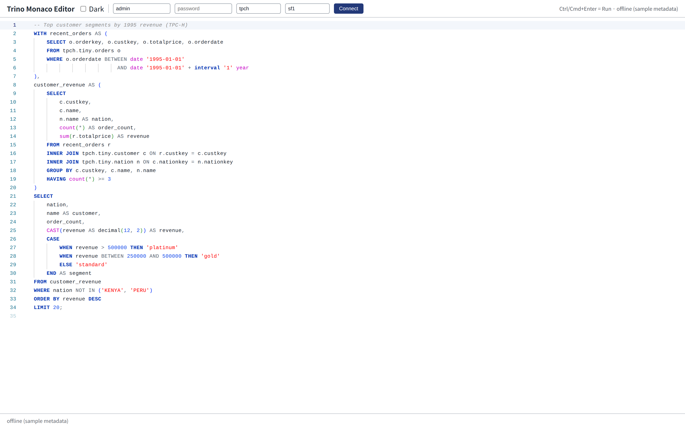
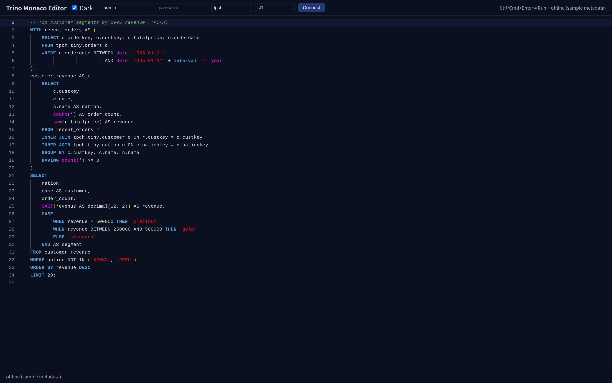

# Monaco based SQL Editor for Trino

> English · [한국어](./README.ko.md)

A **Trino SQL editor** component for React, built on the
[Monaco Editor](https://microsoft.github.io/monaco-editor/). Self-contained and
worker-free: the `trino` language is adapted from Monaco's open-source SQL
definition (MIT) and the keyword/function lists come from the public
[Trino documentation](https://trino.io/docs/).



<details>
<summary>Dark theme</summary>



</details>

## Features

- ✅ `trino` language registration (Monarch tokenizer + language configuration)
- 🎨 Light / dark Trino themes
- 💡 Autocomplete: built-in **keywords**, **functions**, **types**, plus an
  optional async **metadata provider** for catalog/schema/table/column
- ⌨️ Actions: **Run query** (`Ctrl/Cmd+Enter`), **Explain Query**,
  **Prettify** (`Shift+Alt+F`), **Show Help** (`Shift+F1`) — also in the right-click menu
- 📖 Built-in help for functions, keywords and types on hover, `Shift+F1` or
  `Ctrl/Cmd+Click`, linked to the Trino documentation
- 🌐 UI languages: English, Korean, Japanese, Chinese (`locale`)
- 🔤 Editor font picker: D2Coding Ligature by default, plus JetBrains Mono,
  Fira Code, Cascadia Code, Source Code Pro, IBM Plex Mono
- 🧩 Compact 12px layout, no minimap, fixed overflow widgets
- 🔌 Controlled or uncontrolled, fully typed (TypeScript)

## Install

```bash
npm install
```

`react`, `react-dom` are peer dependencies; `@monaco-editor/react` and
`monaco-editor` are bundled as dependencies.

## Run the demo

```bash
npm run dev      # open the printed localhost URL
```

## Usage

```tsx
import { TrinoEditor } from "trino-monaco";

export function MyEditor() {
  const [sql, setSql] = useState("SELECT 1");

  return (
    <TrinoEditor
      value={sql}
      onChange={setSql}
      theme="dark"
      height="400px"
      onRunQuery={(query) => console.log("RUN:", query)}
      onExplainQuery={(query) => console.log("EXPLAIN:", query)}
    />
  );
}
```

### Editor options

Pass Monaco options through the `options` prop. They are shallow-merged over the
package defaults (`DEFAULT_EDITOR_OPTIONS` — 12px font, minimap off, 8px padding,
etc.), so you only specify what you want to change:

```tsx
<TrinoEditor
  theme="dark"
  height="500px"
  defaultValue="SELECT * FROM system.runtime.nodes"
  options={{
    fontSize: 14,                 // default 12
    lineNumbers: "relative",
    minimap: { enabled: true },   // default is off
    wordWrap: "on",
    tabSize: 4,                   // default 2
    renderWhitespace: "boundary",
    cursorBlinking: "phase",
    scrollbar: { verticalScrollbarSize: 14 },
  }}
/>
```

Notes:
- The merge is **shallow** — nested objects like `minimap` / `scrollbar` are
  replaced wholesale, not deep-merged. To keep other `scrollbar` defaults,
  re-specify them.
- Don't pass `language` / `theme` via `options`; use the `theme` prop (the
  component manages the language). See `src/trino/options.ts` for all defaults.

### Schema-aware autocomplete

Provide a `metadataProvider` to surface catalogs, schemas, tables and columns
(typically backed by the Trino metadata API):

```tsx
<TrinoEditor
  metadataProvider={async ({ word }) => {
    const rows = await fetchMetadata(word); // your API
    return rows.map((r) => ({ label: r.name, kind: r.kind, detail: r.type }));
  }}
/>
```

### Context-aware completion + grammar validation (ANTLR + antlr4-c3)

Set `contextAware` to enable a Web Worker that parses the SQL with an ANTLR
grammar and uses [antlr4-c3](https://github.com/mike-lischke/antlr4-c3) to
determine — from the grammar's ATN — exactly what is valid at the caret. The
heavy parsing runs off the main thread (via [Comlink](https://github.com/GoogleChromeLabs/comlink)),
so typing stays smooth. Grammar errors are shown as markers (`validateOnType`).

```tsx
<TrinoEditor
  contextAware
  metadataProvider={async (ctx) => {
    // ctx tells you what the grammar expects at the caret:
    if (ctx.qualifier?.length) {
      // `alias.` -> resolve columns of that alias/table
      const table = ctx.aliases?.find(a => a.alias === ctx.qualifier!.at(-1))?.table;
      return columnsOf(table).map(c => ({ label: c.name, kind: "column", detail: c.type }));
    }
    if (ctx.expectTable)  return (await listTables()).map(t => ({ label: t, kind: "table" }));
    if (ctx.expectColumn) return (await listColumns()).map(c => ({ label: c.name, kind: "column" }));
    return [];
  }}
/>
```

The `metadataProvider` context carries `expectTable`, `expectColumn`,
`qualifier` (e.g. `["a"]` for `a.`) and resolved `aliases` (`{ alias, table }`).
Keywords and functions are added automatically from the parser context, so the
editor only ever suggests what is grammatically valid at that position.

**Statement coverage.** The completion grammar (`src/grammar/TrinoSql.g4`)
understands:

- Queries: `SELECT`, `WITH` (CTEs), set operations (`UNION` / `INTERSECT` /
  `EXCEPT`), `VALUES`, subqueries, joins
- DML: `INSERT`, `UPDATE`, `DELETE`, `MERGE`
- DDL / utility: `CREATE TABLE` (incl. `CTAS`), `CREATE VIEW`, `CREATE SCHEMA`,
  `DROP`, `ALTER TABLE`, `TRUNCATE`, `SHOW`, `DESCRIBE`, `EXPLAIN`, `USE`, `CALL`
- Expressions: function calls, `CASE`, `CAST`, predicates, qualified names,
  `INTERVAL` literals (`interval '3' month`, `interval '1' day to hour`) and
  typed literals (`date '2020-01-01'`, `timestamp '2020-01-01 00:00:00'`)

Existing-object positions (`FROM`, `DROP TABLE`, `DELETE FROM`, `UPDATE`,
`INSERT INTO`, `SHOW COLUMNS FROM`, …) drive table suggestions; column positions
(`SELECT`, `WHERE`, `UPDATE SET`, `INSERT (cols)`, …) drive column suggestions.
New-object names (`CREATE` targets, column definitions) intentionally do **not**
suggest existing objects.

Regenerate the parser with `npm run gen:parser` and run the context tests with
`npm run test:core` (30 assertions across query/DML/DDL/literals).

### Live metadata from a Trino cluster

`createTrinoMetadataProvider` is a ready-made `metadataProvider` that answers the
caret context by querying Trino over its REST protocol (`SHOW CATALOGS /
SCHEMAS / TABLES / COLUMNS`), with a TTL cache, in-flight de-duplication and
per-round request cancellation:

```tsx
import { TrinoEditor, createTrinoMetadataProvider } from "trino-monaco";

const metadata = createTrinoMetadataProvider({
  baseUrl: "https://trino.example.com:8443",
  user: "alice",
  authorization: "Basic " + btoa("alice:secret"),
  catalog: () => session.catalog, // getter so `USE` changes take effect
  schema: () => session.schema,
  cacheTtlMs: 5 * 60_000,
});

<TrinoEditor contextAware metadataProvider={metadata} />;
```

It maps context to queries automatically:

| Caret | Query |
|---|---|
| `FROM \|` | `SHOW CATALOGS` + `SHOW SCHEMAS` + `SHOW TABLES` (current schema) |
| `FROM cat.\|` | `SHOW SCHEMAS FROM cat` |
| `FROM cat.sch.\|` | `SHOW TABLES FROM cat.sch` |
| `WHERE a.\|` (alias `a` → `orders`) | `SHOW COLUMNS FROM …orders` |
| `SELECT \| FROM t a` | `SHOW COLUMNS` for each in-scope table |

Run `npm test` for the full suite (`test:core` + `test:metadata`, the latter
exercises the REST protocol, pagination, caching and qualifier routing with a
mocked fetch).

## Connecting to a cluster

The editor talks to Trino at **two** points: metadata (autocomplete) via
`createTrinoMetadataProvider`, and **query execution** via `createTrinoQueryRunner`
wired to `onRunQuery`.

```tsx
import {
  TrinoEditor,
  createTrinoMetadataProvider,
  createTrinoQueryRunner,
  basicAuth,
} from "trino-monaco";

const conn = {
  baseUrl: "/trino",                         // same-origin proxy (see below)
  user: "admin",
  authorization: basicAuth("admin", "secret"),
  catalog: () => "tpch",
  schema: () => "tpch",
  // Trino returns ABSOLUTE nextUri URLs — route them back through the proxy:
  rewriteNextUri: (u) => u.replace(/^https?:\/\/[^/]+/, "/trino"),
};

const metadata = createTrinoMetadataProvider(conn);
const run = createTrinoQueryRunner(conn);

<TrinoEditor
  contextAware
  metadataProvider={metadata}
  onRunQuery={async (sql) => {
    const { columns, rows } = await run(sql.replace(/;\s*$/, ""));
    renderResults(columns, rows);
  }}
/>;
```

`createTrinoQueryRunner` streams pages (`onPage`), surfaces `TrinoQueryError`,
and cancels server-side (HTTP `DELETE`) when you abort via `RunQueryOptions.signal`.

### Gateway (recommended for shared deployments)

`servers/` holds a small gateway that gives each user **their own Trino session**:
the user logs in once with their own Trino account, the browser keeps only an
httpOnly session cookie, and the gateway forwards the Trino client protocol to
a configured cluster, keeping `USE`, `SET SESSION`, `PREPARE` and transactions
across statements. The same API is implemented three times:

| Gateway | Stack |
|---|---|
| [`servers/server-node/`](./servers/server-node/README.md) | Fastify (API and security reference) |
| [`servers/server-python/`](./servers/server-python/README.md) | FastAPI + httpx |
| [`servers/server-java/`](./servers/server-java/README.md) | Spring Boot + `java.net.http` |

```tsx
import { createTrinoGatewayClient, createTrinoMetadataProvider, createTrinoQueryRunner } from "trino-monaco";

const gw = createTrinoGatewayClient();                 // same-origin "/api"
const aliases = await gw.aliases();                    // clusters configured on the gateway
const session = await gw.login({ connectAlias: "dev", user, password });
const conn = gw.connection(session);                   // catalog / schema follow USE
const metadata = createTrinoMetadataProvider(conn);
const run = createTrinoQueryRunner(conn);
// …
await gw.logout(session);                              // cancels queries, rolls back a transaction
```

Run any one of the three (all listen on `127.0.0.1:8787` by default):

```bash
export TRINO_CLUSTERS='{"dev":{"url":"https://trino.example.com:8443","label":"Development","catalog":"tpch","schema":"sf1"}}'
export SECURE_COOKIE=false   # local http development only (the demo runs on http://localhost)

# Node
(cd servers/server-node && npm install) && npm run gateway

# Python
(cd servers/server-python && python3 -m venv .venv && .venv/bin/pip install -e '.[test]')
(cd servers/server-python && .venv/bin/python -m trino_monaco_gateway)

# Java
(cd servers/server-java && mvn -q package -DskipTests && java -jar target/trino-monaco-gateway.jar)
```

Then start the demo in another terminal: `npm run dev` proxies `/api` to
`http://127.0.0.1:8787` (change it with `VITE_TRINO_GATEWAY`). When a gateway
answers, the demo shows a cluster / user / password login; otherwise it calls
Trino directly through `/trino`. All settings (`TRINO_CLUSTERS` options,
timeouts, DDL policy, …) are listed in
[`servers/server-node/README.md`](./servers/server-node/README.md).

Tests (no cluster needed):

```bash
npm run test:gateway   # Node gateway tests + library client end-to-end test (after npm install in servers/server-node)
(cd servers/server-python && .venv/bin/python -m pytest)   # Python gateway tests
(cd servers/server-java && mvn test)                      # Java gateway tests
```

### CORS / proxy

A browser can't call Trino directly (no CORS headers) and shouldn't hold
credentials. Proxy through your own origin. The demo uses a Vite proxy:

```ts
// vite.config.ts
server: {
  proxy: {
    "/trino": {
      target: process.env.VITE_TRINO_TARGET ?? "https://your-cluster:8443",
      changeOrigin: true,
      secure: false,            // self-signed certs
      rewrite: (p) => p.replace(/^\/trino/, ""),
    },
  },
}
```

Then run the demo against your cluster and click **Connect**:

```bash
VITE_TRINO_TARGET=https://your-cluster:8443 npm run dev
```

### Authentication

`/v1/statement` on Trino / Starburst Enterprise uses **Basic** (password) or
**Bearer** (JWT) — *not* the web-UI form-login cookie. Use `basicAuth(user, pass)`
or set `authorization: "Bearer <token>"`. `createStarburstFetch` is provided for
the rare setups that proxy the REST API behind the web-UI session
(`formLogin: true`); otherwise prefer Basic.

> In production, terminate auth in **your** backend (keep the password off the
> browser) and point `baseUrl` at your API: `browser → your API → Trino`.

`npm run test:live` runs an end-to-end check against a real cluster
(`TRINO_URL`, `TRINO_USER`, `TRINO_PASS`).

### Built-in help and UI languages

Hover a keyword, function or data type — or press `Shift+F1` / `Ctrl/Cmd+Click`
on it — to see its syntax, a short summary, an example and a link to the
matching page of the Trino documentation. The help covers every built-in
function, ~70 statements / clauses / operators (chosen by context:
`CREATE TABLE … AS`, `IS NOT NULL`, `count(*) FILTER (WHERE …)` vs
`filter(array, …)`) and the data types. Function completions carry the same help.

`locale` switches action labels, the help text, completion details and
grammar-check messages between English, Korean, Japanese and Chinese:

```tsx
<TrinoEditor locale="ko" hover={false} />   // help only on Shift+F1 / Ctrl+Click
```

### Editor fonts

The default code font is **D2Coding Ligature** (Hangul + ligatures).
`TRINO_EDITOR_FONTS` lists recommended monospace fonts (D2Coding Ligature,
JetBrains Mono, Fira Code, Cascadia Code, Source Code Pro, IBM Plex Mono); the
library only names them, so the host page loads the font files (the demo
bundles them from npm). The editor re-measures glyphs once the font has loaded.

```tsx
const font = TRINO_EDITOR_FONTS[1];
<TrinoEditor fontFamily={font.fontFamily} fontLigatures={font.ligatures} />
```

### Extending the language

```tsx
<TrinoEditor
  languageElements={{
    functions: [...TRINO_FUNCTIONS, "my_udf"],
  }}
  formatter={(sql) => myCustomFormatter(sql)}
/>
```

## Props

| Prop | Type | Default | Description |
|---|---|---|---|
| `value` | `string` | — | Controlled value |
| `defaultValue` | `string` | — | Uncontrolled initial value |
| `onChange` | `(value: string) => void` | — | Content change callback |
| `onRunQuery` | `(sql, editor) => void` | — | `Ctrl/Cmd+Enter` / menu |
| `onExplainQuery` | `(sql, editor) => void` | — | Explain Query action |
| `theme` | `"light" \| "dark"` | `"light"` | Color theme |
| `readOnly` | `boolean` | `false` | Read-only mode |
| `languageElements` | `Partial<TrinoLanguageElements>` | built-ins | Override keywords/functions/operators/types |
| `metadataProvider` | `MetadataProvider` | — | Async catalog/schema/table/column suggestions |
| `formatter` | `Formatter` | built-in | Custom SQL formatter |
| `contextAware` | `boolean` | `false` | Enable ANTLR/c3 worker completion + validation |
| `validateOnType` | `boolean` | `true` | Grammar error markers (context-aware mode) |
| `locale` | `"en" \| "ko" \| "ja" \| "zh"` | `"en"` | UI language: actions, help, completion details, grammar messages |
| `hover` | `boolean` | `true` | Built-in help when the mouse rests on a keyword / function / type |
| `help` | `boolean` | `true` | Built-in help on `Shift+F1` / `Ctrl/Cmd+Click` (also with `hover={false}`) |
| `fontFamily` | `string` | D2Coding Ligature | Code font (see `TRINO_EDITOR_FONTS`) |
| `fontLigatures` | `boolean` | `true` | Programming ligatures |
| `options` | Monaco options | — | Merged over defaults |
| `height` / `width` | `string \| number` | `"100%"` | Editor size |
| `onMount` | `(editor, monaco) => void` | — | Escape hatch |

## Build the library

```bash
npm run build        # -> dist/ (ES module + d.ts)
npm run build:demo   # -> dist/ static demo site
```

## Architecture

Design notes (decisions, completion pipeline, metadata routing, connection layer, gateway security model) are in [`docs/DESIGN.md`](./docs/DESIGN.md) (Korean).

```
src/
  TrinoEditor.tsx        Main React component (@monaco-editor/react wrapper)
  index.ts               Public exports
  trino/
    language.ts          Monarch tokenizer + language configuration
    keywords.ts          Keywords / functions / operators / types
    themes.ts            Light & dark themes
    options.ts           Default editor options
    completion.ts        Static completion item provider (+ metadata provider type)
    connection.ts        Shared Trino REST client (statement protocol)
    metadata.ts          createTrinoMetadataProvider (live Trino REST + cache)
    runner.ts            createTrinoQueryRunner (execute + stream + cancel)
    auth.ts              basicAuth / createStarburstFetch
    format.ts            Lightweight SQL formatter
    docs.ts              Built-in help (functions / keywords / types, doc links)
    hover.ts             Help hover (hover, Shift+F1, Ctrl/Cmd+Click)
    i18n/                UI languages (en / ko / ja / zh) and help translations
    fonts.ts             Recommended editor fonts
    gateway.ts           createTrinoGatewayClient (login, session-bound connection)
    setup.ts             Registers language/themes/completion with Monaco
  grammar/
    TrinoSql.g4          ANTLR grammar for context-aware completion
  generated/             ANTLR-generated lexer/parser (npm run gen:parser)
  worker/
    completion.worker.ts Web Worker entry (Comlink.expose)
    completionCore.ts    Parse + antlr4-c3 candidate collection (pure logic)
    contextProvider.ts   Context-aware Monaco completion provider
    client.ts            Spawns + Comlink-wraps the worker
    protocol.ts          Shared worker/main types
  App.tsx / main.tsx     Demo app (appStrings.ts: demo text, fonts.ts: bundled fonts)
scripts/
  gen-parser.mjs         Regenerate parser + inject @ts-nocheck
  test-core.ts           Node smoke test for the c3 completion core
  test-metadata.ts       Node test for the Trino REST metadata provider
  test-runner.ts         Node test for the query runner (poll/cancel/stream)
  test-live.ts           End-to-end test against a real cluster (opt-in)
  test-docs.ts           Node test for the built-in help and UI languages
  test-gateway-client.ts Library client → Node gateway → fake Trino (npm run test:gateway)
  check-doc-links.ts     Checks the help links against trino.io (network)
```

```
servers/                 gateways (same API and security model)
  server-node/           Fastify — servers/server-node/README.md (API reference)
  server-python/         FastAPI + httpx — servers/server-python/README.md
  server-java/           Spring Boot + java.net.http — servers/server-java/README.md
```

## Attribution

- The Trino Monarch tokenizer and language configuration in `src/trino/language.ts`
  are **adapted from the Monaco Editor open-source SQL language definition**
  (`microsoft/monaco-editor`, `src/basic-languages/sql/sql.ts`), licensed under
  the MIT License — see [`NOTICE`](./NOTICE).
- Keyword, function, operator and type lists are compiled from the public
  [Trino SQL reference documentation](https://trino.io/docs/) (factual language data).
- Themes, editor options, completion provider, formatter and the React component
  are original to this project.
- Context-aware completion uses [antlr4ng](https://github.com/mike-lischke/antlr4ng)
  (BSD-3), [antlr4-c3](https://github.com/mike-lischke/antlr4-c3) (MIT) and
  [Comlink](https://github.com/GoogleChromeLabs/comlink) (Apache-2.0). The grammar
  in `src/grammar/TrinoSql.g4` is written from scratch (inspired by the structure
  of Trino's Apache-2.0 `SqlBase.g4`).

## License

MIT — see [`LICENSE`](./LICENSE).
